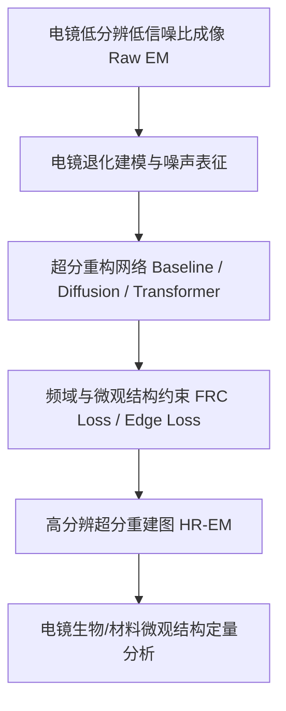

# 🔬 电镜超分辨率重建 (Electron Microscopy Super-Resolution) 项目总览

## 1. 课题背景与目标
- **目标**: 利用深度学习（超分辨率重建 / 逆问题求解 / 扩散模型 / Transformer）提升电子显微镜（SEM / TEM / Cryo-EM）成像的分辨率与信噪比，突破传统物理成像极限与辐照损伤制约。
- **难点**:
  1. 电镜图像噪声特性复杂（泊松-高斯混合噪声、散斑效应）；
  2. 真实电镜的高/低分辨率配准对极度困难（通常缺乏成对监督真实数据，需探索自监督/无监督/退化建模）；
  3. 保真度与高频生物/材料微观结构的真实性要求极高，防止产生伪影（Hallucination）。

---

## 2. 工程与实验环境链路
- **本地代码目录**: 本地工作目录与代码仓库
- **运行环境**: 本地 Conda 环境 `pytorch` (`D:\Anaconda\envs\pytorch\python.exe`)
- **关联 GitHub 代码仓库**: [Chisato-reco/chisato_reco](https://github.com/Chisato-reco/chisato_reco)
- **笔记知识库 (本仓库)**: [Chisato-reco/obsidian_chaofen](https://github.com/Chisato-reco/obsidian_chaofen)

---

## 3. 技术路线与关键模块

---

## 4. 近期任务清单 (TODO)
- [ ] 梳理电镜超分与显微图像增强的 SOTA 文献（在 Zotero 中建立专门分类并同步导入本笔记）
- [ ] 调试本地 `pytorch` 环境中的 `chisato_reco` 基准训练代码
- [ ] 准备电镜测试数据集与基准评估脚本 (PSNR, SSIM, FRC)
- [ ] 开展首轮对比基准实验并撰写实验记录（存入 `30_Experiments/`）
